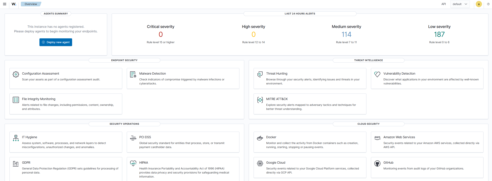
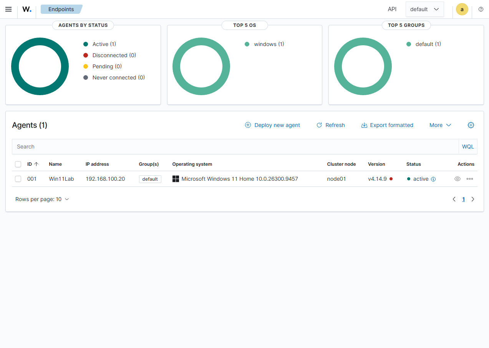
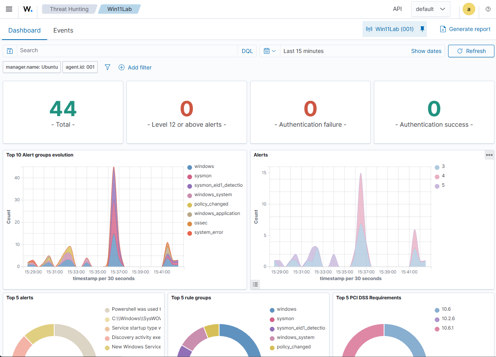
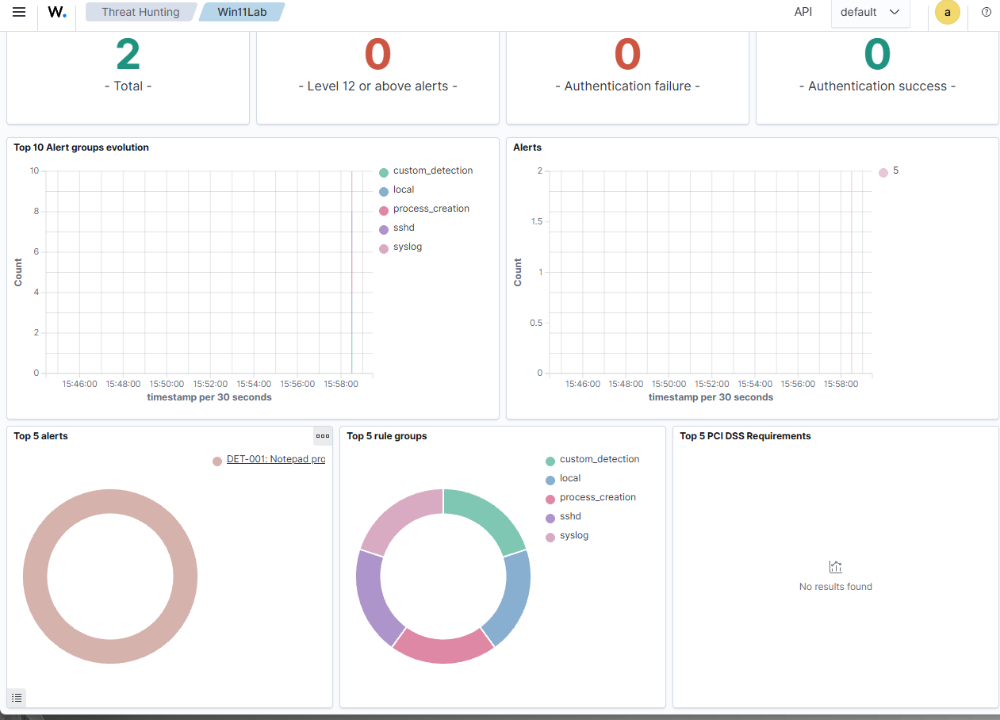
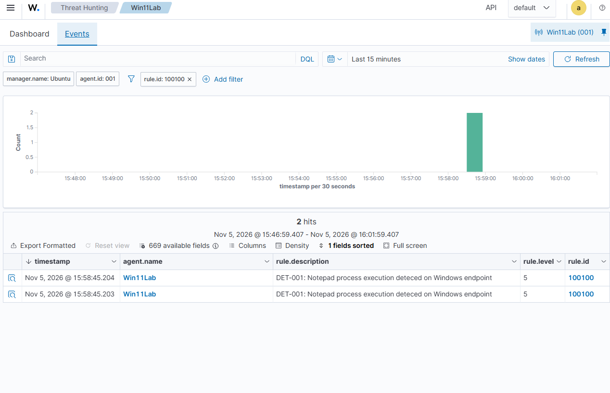
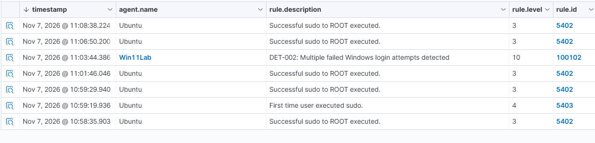

## Wazuh SIEM Dashboard

## Windows Endpoint Integration

### Sysmon Integration and Event Monitoring

Successfully integrated Microsoft Sysmon with Wazuh to monitor Windows endpoint activity.

Configured the Wazuh agent to collect events from the `Microsoft-Windows-Sysmon/Operational` channel.

Verified successful event ingestion and alert generation through the Wazuh Threat Hunting dashboard.

**Validation Results:**
- Monitored endpoint: Win11Lab
- Sysmon event collection: Operational
- Process creation monitoring: Event ID 1
- Wazuh alerts observed: 44 within a 15-minute monitoring window
- Sysmon-related alert groups: `sysmon`, `sysmon_eid1_detection`

### DET-001: Windows Process Creation Detection

**Status:** Successfully tested

**Objective:** Develop a custom Wazuh detection rule to identify a specific process executing on a monitored Windows endpoint.

**Data Source:** Microsoft Sysmon — Event ID 1 (Process Creation)

**Detection Logic:** The rule examines the process image field in Sysmon events and identifies executions of `notepad.exe`.

**Implementation:** Created a custom XML detection rule (ID `100100`) using Wazuh's rule engine, assigned alert level 5, and grouped detections under `custom_detection` and `process_creation`.

**Validation:** Executed Notepad within the Windows 11 lab environment and observed two Level 5 alerts in the Wazuh Threat Hunting dashboard.

**Outcome:** Successfully demonstrated custom rule development, Sysmon event processing, and endpoint detection validation.

### DET-002: Multiple Failed Windows Login Detection

**Status:** Successfully tested and validated

**Objective:** Identify repeated Windows authentication failures that could indicate password-guessing activity.

**Data Source:** Windows Security Event ID 4625

**Detection Logic:** Correlates five matching authentication failure events within a 120-second window using Wazuh's `frequency`, `timeframe`, and `if_matched_sid` capabilities.

**Rule Configuration:**
- Custom Rule ID: `100102`
- Alert Severity: Level 10
- Parent Detection Rule: `60122`
- MITRE ATT&CK: T1110 — Brute Force

**Testing:** Generated controlled failed-login events against a disposable local Windows account inside an isolated VirtualBox lab environment.

**Validation Results:** Confirmed Wazuh generated a Level 10 alert with Rule ID `100102` for the monitored endpoint `Win11Lab`.

**Outcome:** Successfully implemented and validated an authentication event correlation rule, demonstrating SIEM detection engineering and event analysis capabilities.

